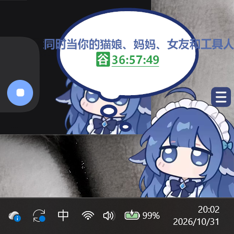
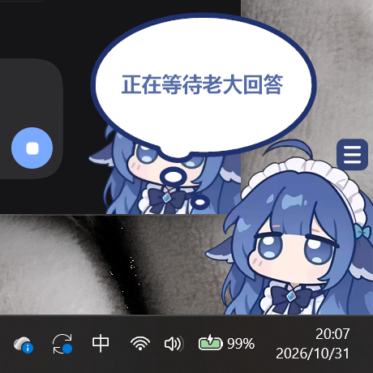
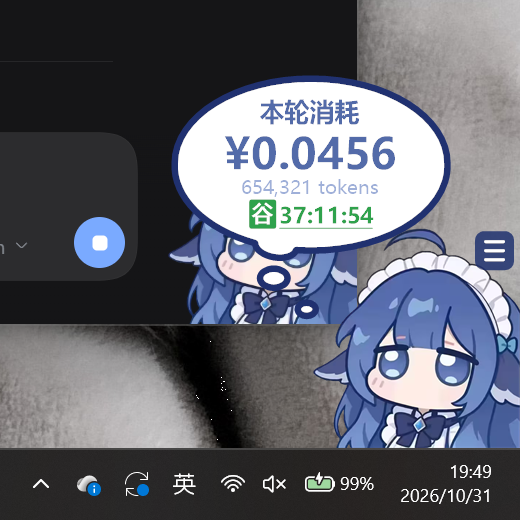

# 桌面小鲸鱼（DSH Whale Pet · Desktop）

把 **DeepSeek Harness（DSH）** Web 界面右下角那只小鲸鱼，搬到 Windows 桌面上。

透明无边框、始终置顶、独立进程 —— **DSH 关掉它还在**。

| 余额 + 峰谷 | 对话 |
|---|---|
|  |  |

| 等你决策 | 每轮消耗 |
|---|---|
|  |  |

## 特性

- **外观照搬插件**：立绘占容器 59.45%、贴右下角；思考泡泡用 `dsh-whale-widget` 的 `FRAME_CLASSIC_BIG_D` 原路径（viewBox 1026×700、`#203170` 18 宽描边、尾巴 + 两个小圆点）；字号/颜色/行高按插件的模块配置换算。
- **点击分工**：点鲸鱼出余额卡（余额 / 今日已用 / 峰谷倒计时），点气泡换一句对话（85 条，按权重抽、不连续重复，长句自动换行 + 缩字号）。
- **峰谷实时**：工作日 9–12 / 14–18 为峰，其余、周末、法定节假日为谷；倒计时跨天不清零。
- **每轮消耗**：读 DSH 账本里的逐轮事件，回合结束自动弹「本轮消耗 ¥x / n tokens」。
- **等你决策**：读 DSH 会话缓存里的 `questions.active`，有挂起问题就显示「正在等待老大回答」并置顶。
- **消耗 API 时自动出现**：`~/.dsh/.dshw-turn.json` 的 `seq` 或 `busy` 字段一变就置顶冒出，结束 2 秒后收起（默认开，可在菜单关）。DSH 侧由插件自动写 `seq`；Claude Code 侧可用两个 hook 写 `busy`（见下方「Claude Code 联动」）。
- **按压手感**：整只挂件 `scaleY .88 / scaleX 1.05`（原点在底部中心），SmoothDamp 临界阻尼 + 1ms 定时器精度；**按下瞬间气泡文字即全显**（无开合动画，轮次弹出同理）。
- **贴边吸附 + 贴左镜像**：拖到屏幕四边 26px 内自动吸附；贴左时只镜像立绘与泡泡，**文字保持正向可读**。
- **手形光标**：悬停是张开的手，按下变握拳（运行时生成 32/48/64 多尺寸 `.cur`）。
- **按压音效**：`Ya1/Ya2`（小黄鸭组）或 `D1/D2`（音效 1 组），**直接读已安装插件的 assets 目录**（与 DSH 网页版同一份文件，本地 assets 作兜底）；按压 / 松开各走一个 WMP 实例（按下放 Ya1，松开的 Ya2 与 Ya1 尾音轻微交叠）。另有事件音效：任务结束 `cost_a`（默认开）、提问 `ask_a`（默认只冒泡不响），开关读账本 settings，音量跟随按压音量。
- 透明区域**点击穿透**（只有不透明像素吃鼠标），位置/大小/翻转状态持久化，单实例运行。

## 运行

1. 双击 `WhalePet.exe`（首次运行会写「开机自启」，可在右键菜单关）。
2. 需要 **.NET Framework 4.8**（Windows 10/11 自带）。

菜单：每轮消耗提示 · 直连官网刷新余额 · 消耗 API 时自动出现 · 退出后自动回来（看门狗）· 刷新余额 · 大小 · 始终置顶 · 开机自启 · 在桌面创建快捷方式 · 回到右下角 · 退出。

## 构建

素材（立绘 + 音效）来自 `dsh-whale-widget` 插件，**不随本仓库分发**（见 [NOTICE.md](NOTICE.md)）。先在本机把素材准备好，再编译：

```powershell
# 1. 从已安装的 dsh-whale-widget 复制素材到 assets/
powershell -ExecutionPolicy Bypass -File tools\prepare-assets.ps1

# 2. 编译（csc 随 .NET Framework 4.8 自带）
powershell -ExecutionPolicy Bypass -File tools\build.ps1
```

产物是 `dist\WhalePet.exe`（素材已嵌入 exe）。

## 数据来源

| 数据 | 位置 | 说明 |
|---|---|---|
| 余额 / 今日已用 / 逐轮事件 | `%USERPROFILE%\.dsh\.dshw-usage.json` | 由 `dsh-whale-widget` 插件写入，本程序只读 |
| 回合序号 / 忙闲 | `%USERPROFILE%\.dsh\.dshw-turn.json` | `seq` 每轮 +1（DSH 写）；`busy` true/false（Claude Code hooks 写）；变了就冒出来 / 收起 |
| 待回答的问题 | `%USERPROFILE%\.dsh\storages\session_projcache\sessions\*.json` | 读最新的那个，看 `userQuestions.val.questions.active` |
| 插件设置 | `%USERPROFILE%\.dsh\.dshw-size.json` | `sound` / `pressOn` / `vol` / `soundSet` / `turnCostOn` / `turnCostCloseMs` |
| API Key（可选） | `%USERPROFILE%\.dsh\.credentials.yaml` | 只有开启「直连官网刷新余额」时才用来请求 `api.deepseek.com/user/balance` |

全部只读（除了自己的 `whale-pet.json` 存位置）；不联网，除非你打开「直连官网」。

调试用环境变量：`DSH_WHALE_USAGE` / `DSH_WHALE_TURN` / `DSH_WHALE_SESSIONS` / `DSH_WHALE_FRAMESHOT` / `DSH_WHALE_POS` / `DSH_WHALE_QUIP`。

## 已知限制

- 「直连官网余额」在受限网络里会失败，失败自动退回读账本，不影响使用。
- 余额预警阈值存在 DSH 网页的 localStorage 里，桌面版读不到，未实现。
- 法定节假日表内置的是 **2026 年**（与插件 `HOLIDAY_VALLEY` 一致），次年需要补。
- 按压 / 松开音走两个 WMP COM 实例，MCI 只用来量 Ya1 时长；没有媒体组件的 Windows N 版会静音。

## Claude Code 联动

在 Claude Code 里消耗 DeepSeek API 时（如经 CC Switch 代理），加两个 hook 让鲸鱼同样冒出来。仓库自带现成的信号小程序 `signal\WhaleSignal.cs`（`tools\build.ps1` 会顺带编译出 `dist\WhaleSignal.exe`，或单独跑 `signal\build.bat`）：

1. 把 `WhaleSignal.exe` 放到 `%USERPROFILE%\.dsh\whale-signal\`（或任意固定位置）
2. 在 `%USERPROFILE%\.claude\settings.json` 里加：

```json
{
  "hooks": {
    "UserPromptSubmit": [{ "hooks": [{ "type": "command", "command": "C:\\Users\\<你>\\.dsh\\whale-signal\\WhaleSignal.exe", "args": ["start"] }] }],
    "Stop": [{ "hooks": [{ "type": "command", "command": "C:\\Users\\<你>\\.dsh\\whale-signal\\WhaleSignal.exe", "args": ["stop"] }] }]
  }
}
```

`start` = `seq+1` 且 `busy:true`（鲸鱼立刻冒出，气泡显示余额卡）；`stop` = `busy:false`（2 秒后收起）。DSH 自己写 `seq` 不带 `busy`，互不干扰。

**鲸鱼被退出后，下一次消耗 API 会自动把它拉起来**：`WhaleSignal` 在写信号前会检查鲸鱼的互斥体，没在跑就从自启注册表项 `DSHWhalePet` 找到 exe 直接启动（找不到再回退到 `Documents\deepseek-harness\default-workspace\desktop-whale\WhalePet.exe`），随后鲸鱼读到 `busy:true` 立即弹出。

## 许可

代码 MIT。立绘 / 音效的版权不属于本项目，见 [NOTICE.md](NOTICE.md)。
